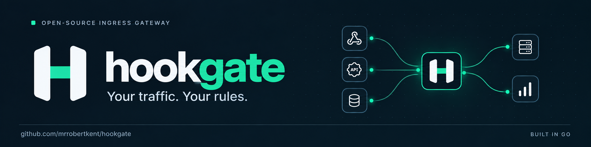
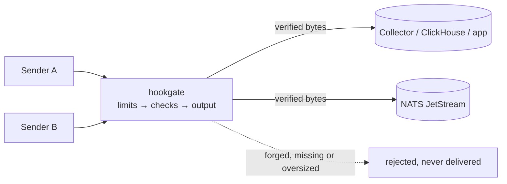

<picture>
  <source media="(prefers-color-scheme: dark)" srcset=".github/assets/banner-dark.png">
  <source media="(prefers-color-scheme: light)" srcset=".github/assets/banner-dark.png">
  
</picture>

# hookgate

hookgate is a lightweight webhook gateway: a single static binary that checks each incoming webhook against its sender's signature or token and delivers only authentic requests, byte for byte, to your OpenTelemetry Collector, ClickHouse, Vector or any HTTP backend, or into a replicated NATS JetStream stream.

[Configuration](docs/configuration.md) · [Event contract](docs/contract.md) · [Relay](docs/relay.md) · [High availability](docs/high-availability.md) · [Releases](https://github.com/mrrobertkent/hookgate/releases) · [Example](examples/hookgate.yaml) · [Security](SECURITY.md)

[](https://github.com/mrrobertkent/hookgate/actions/workflows/ci.yml)
[](https://github.com/mrrobertkent/hookgate/releases/latest)
[](https://pkg.go.dev/github.com/mrrobertkent/hookgate)
[](LICENSE)
[](https://sonarcloud.io/summary/new_code?id=mrrobertkent_hookgate)
[](https://scorecard.dev/viewer/?uri=github.com/mrrobertkent/hookgate)
[](https://www.bestpractices.dev/projects/15295)
[](https://www.bestpractices.dev/projects/15295)
[](https://github.com/mrrobertkent/hookgate/pkgs/container/hookgate)

## Why hookgate

Data pipelines are built to accept whatever arrives. A webhook endpoint in front of one is a public write path: anyone who finds the URL can insert rows. Most pipeline receivers check a static header at best, and few can verify an HMAC signature over the raw body, let alone the different scheme each sender uses.

hookgate closes that path:

- **Verifies per sender.** Static tokens, HMAC-SHA1/256/512 signatures in hex, base64 or base64url with prefixes and multi-signature headers, and Standard Webhooks (Svix) signatures with timestamp checks. Every check of a source must pass.
- **Fails closed.** A missing or too-short secret takes its own source offline (`503`), never open. Unknown config keys stop startup.
- **Delivers exactly what it verified.** The output receives the verified bytes and an allowlist of headers, nothing else, with retries across instances.
- **Saves, then acknowledges.** With the JetStream output the sender gets `200` only once the stream holds the event; large bodies go to an Object Store first (claim check).
- **Costs almost nothing.** One ~16 MB distroless image, no database, no queue, Prometheus metrics built in.

## How it works



1. The request path, and the host when the source lists hosts, selects a source; anything else is `404`.
2. Method, query string, encoding and body size are checked (`405`, `400`, `415`, `413`).
3. Every check of the source runs against the raw body. A failure returns `401` and nothing is delivered.
4. The verified bytes go to the source's output. An HTTP output retries transport errors and `5xx` responses on the next instance and returns the upstream's response; a JetStream output answers `200` once the stream has stored the event and `503` when it cannot.

## Quick start

```sh
docker network create hookgate-demo
docker run -d --rm --name echo --network hookgate-demo ealen/echo-server   # stands in for your backend

cat > hookgate.yaml <<'EOF'
sources:
  - name: github
    path: /github
    checks:
      - hmac:
          header: X-Hub-Signature-256
          algorithm: sha256
          prefix: "sha256="
          secrets: [{env: GITHUB_WEBHOOK_SECRET}]
    output:
      http:
        urls: ["http://echo/"]
EOF

docker run --rm --network hookgate-demo -p 8080:8080 -e GITHUB_WEBHOOK_SECRET=demo-secret-change-me \
  -v "$PWD/hookgate.yaml:/etc/hookgate/hookgate.yaml:ro" \
  ghcr.io/mrrobertkent/hookgate:0.2.0@sha256:319b6f8c0cedb815014829451fab873c8be00e13ea21e68984bcb3caba63702a
```

Send a signed request and a forged one:

```sh
BODY='{"zen":"Keep it logically awesome."}'
SIG=$(printf '%s' "$BODY" | openssl dgst -sha256 -hmac demo-secret-change-me -hex | awk '{print $NF}')

curl -i localhost:8080/github -H "X-Hub-Signature-256: sha256=$SIG" --data-binary "$BODY"     # 200, echoed by the backend
curl -i localhost:8080/github -H "X-Hub-Signature-256: sha256=$SIG" --data-binary "${BODY}x"  # 401, never forwarded
```

## Install

- **Container:** `ghcr.io/mrrobertkent/hookgate:<version>` (linux/amd64, linux/arm64). Pin a version or digest in production.
- **Docker Compose:** [examples/compose](examples/compose/) runs the pinned image with a health check, a restart policy and both ports on loopback behind your reverse proxy.
- **Binary:** download from [Releases](https://github.com/mrrobertkent/hookgate/releases) and check it with `sha256sum -c checksums.txt`.
- **Go:** `go install github.com/mrrobertkent/hookgate/cmd/hookgate@latest`
- **Relay:** `ghcr.io/mrrobertkent/hookgate-relay:<version>` and `hookgate-relay_*` archives; see [docs/relay.md](docs/relay.md).

### Verify a release

Release archives and images carry SLSA build provenance signed with Sigstore; from v0.1.1, `checksums.txt` and the image are also signed with cosign. All signatures are keyless, issued to the release workflow.

```sh
# archive provenance (also attached to the release as hookgate_<version>.intoto.jsonl)
gh attestation verify hookgate_<version>_linux_amd64.tar.gz --repo mrrobertkent/hookgate

# checksums signature
cosign verify-blob checksums.txt --bundle checksums.txt.sigstore.json \
  --certificate-identity-regexp '^https://github.com/mrrobertkent/hookgate/.github/workflows/release.yml@refs/tags/v' \
  --certificate-oidc-issuer https://token.actions.githubusercontent.com

# image signature and provenance
cosign verify ghcr.io/mrrobertkent/hookgate:<version> \
  --certificate-identity-regexp '^https://github.com/mrrobertkent/hookgate/.github/workflows/release.yml@refs/tags/v' \
  --certificate-oidc-issuer https://token.actions.githubusercontent.com
gh attestation verify oci://ghcr.io/mrrobertkent/hookgate:<version> --repo mrrobertkent/hookgate
```

The relay archives and the `ghcr.io/mrrobertkent/hookgate-relay` image verify the same way.

## Configuration

```yaml
listen: ":8080"            # webhooks
admin_listen: ":9090"      # /healthz, /readyz, /metrics — keep private
drain_delay: 20s           # keep serving after SIGTERM while the load balancer moves away

sources:
  - name: storage
    path: /storage/events
    max_body_bytes: 262144
    checks:                                   # all must pass
      - token:
          header: X-Webhook-Token
          secrets: [{env: STORAGE_TOKEN}]
      - hmac:
          header: X-Notification-Signature
          algorithm: sha256
          encoding: base64
          secrets:
            - env: STORAGE_SIGNING_SECRET
            - env: STORAGE_SIGNING_SECRET_NEXT  # rotation: both verify while set
              optional: true
    output:
      http:
        urls: ["http://otel-collector:8088/storage/events"]
        resolve_all: true                       # every instance behind the name, random order
        pass_headers: [Content-Type]
        set_headers:
          Authorization: {env: UPSTREAM_TOKEN}  # the upstream's own credential
```

Secrets are always references (`env:` or `file:`), never literals. The full reference covers every key, default and status code: [docs/configuration.md](docs/configuration.md).

> [!TIP]
> Run `hookgate validate -config hookgate.yaml` in CI. It fails on unknown keys, impossible settings and unset secrets.

## Verification methods

| Check | Algorithms | Encodings | Extras |
|---|---|---|---|
| `token` | constant-time compare of a header with a shared secret | — | several secrets for rotation |
| `hmac` | HMAC-SHA1, HMAC-SHA256, HMAC-SHA512 over the raw body | hex, base64, base64url | `prefix` (`sha256=`), `separator` for multi-signature headers, several secrets for rotation |
| `standard_webhooks` | HMAC-SHA256 over the event id, timestamp and raw body ([Standard Webhooks](https://www.standardwebhooks.com/) `v1`) | base64 | `webhook-*` or `svix-*` headers, timestamp `tolerance`, `whsec_` secrets, several secrets for rotation |

## Recipes

<details>
<summary><b>Senders</b>: GitHub, Gitea, Bitbucket Cloud, Shopify, Linear, GitLab, iDrive e2</summary>

```yaml
# GitHub
- hmac: {header: X-Hub-Signature-256, algorithm: sha256, encoding: hex, prefix: "sha256=", secrets: [{env: GITHUB_SECRET}]}

# Gitea / Forgejo
- hmac: {header: X-Gitea-Signature, algorithm: sha256, encoding: hex, secrets: [{env: GITEA_SECRET}]}

# Bitbucket Cloud
- hmac: {header: X-Hub-Signature, algorithm: sha256, encoding: hex, prefix: "sha256=", secrets: [{env: BITBUCKET_SECRET}]}

# Shopify
- hmac: {header: X-Shopify-Hmac-Sha256, algorithm: sha256, encoding: base64, secrets: [{env: SHOPIFY_SECRET}]}

# Linear (hookgate checks the signature; Linear's webhookTimestamp is not checked)
- hmac: {header: Linear-Signature, algorithm: sha256, encoding: hex, secrets: [{env: LINEAR_SECRET}]}

# GitLab secret token
- token: {header: X-Gitlab-Token, secrets: [{env: GITLAB_TOKEN}]}

# iDrive e2 event notifications (custom header + signing secret)
- token: {header: X-E2-Token, secrets: [{env: E2_TOKEN}]}
- hmac: {header: X-E2-Notification-Signature, algorithm: sha256, encoding: base64, secrets: [{env: E2_SIGNING_SECRET}]}
```

</details>

<details>
<summary><b>Sender</b>: Resend and other Standard Webhooks (Svix) senders</summary>

Resend [signs with Svix](https://resend.com/docs/webhooks/verify-webhooks-requests): `svix-id`, `svix-timestamp` and `svix-signature` headers and a `whsec_...` signing secret per webhook. Its events carry metadata only ("Webhooks do not include the email body, headers, or attachments", [Resend docs](https://resend.com/docs/webhooks/emails/received)), so a small body cap is enough. For a sender that uses the `webhook-*` headers, leave `headers` at its default.

```yaml
- name: resend
  path: /resend/events
  max_body_bytes: 262144
  checks:
    - standard_webhooks:
        headers: svix
        secrets:
          - env: RESEND_WEBHOOK_SECRET
          - env: RESEND_WEBHOOK_SECRET_NEXT   # rotation: both verify while set
            optional: true
  output:
    jetstream:                          # see "JetStream output" below
      connection: events
      stream: WEBHOOK_EVENTS
      pass_headers: [Content-Type, Svix-Id, Svix-Timestamp]
```

The signed `svix-id` becomes the event ID (`Nats-Msg-Id: resend:<svix-id>`), so Resend's retries of one event are stored once. With an HTTP output instead, use `output: {http: {urls: [...], pass_headers: [Content-Type, Svix-Id, Svix-Timestamp]}}`; the signature header is never passed on either way.

Each webhook endpoint gets its own secret; never reuse one across sources.

</details>

<details>
<summary><b>Upstream</b>: OpenTelemetry Collector <code>webhookevent</code> receiver</summary>

Each verified request becomes one log record. Give every source its own receiver and exporter so one sender's backlog never blocks another. A runnable deployment with durable per-source queues, a ClickHouse variant and a crash test: [examples/otel-collector](examples/otel-collector/).

```yaml
# otel-collector config
extensions:
  bearertokenauth/hookgate:
    scheme: ""
    tokens: ["${env:HOOKGATE_UPSTREAM_TOKEN}"]
receivers:
  webhook_event/storage:
    endpoint: 0.0.0.0:8088
    path: /storage/events
    auth: {authenticator: bearertokenauth/hookgate}
```

```yaml
# hookgate
output:
  http:
    urls: ["http://otel-collector:8088/storage/events"]
    resolve_all: true
    set_headers:
      Authorization: {env: HOOKGATE_UPSTREAM_TOKEN}
```

</details>

<details>
<summary><b>Upstream</b>: ClickHouse HTTP interface</summary>

One verified body becomes one row.

```sql
CREATE TABLE webhooks.github (received_at DateTime64(3) DEFAULT now64(3), body String)
ENGINE = MergeTree ORDER BY received_at;
```

```yaml
output:
  http:
    urls: ["http://clickhouse:8123/?query=INSERT%20INTO%20webhooks.github%20(body)%20FORMAT%20RawBLOB"]
    set_headers:
      X-ClickHouse-User: {env: CLICKHOUSE_USER}      # a user that can only INSERT into this table
      X-ClickHouse-Key: {env: CLICKHOUSE_PASSWORD}
```

ClickHouse answers after the insert, so a `200` to the sender means the row is stored. Parse the JSON later with `JSONExtract*` or a materialized view.

</details>

<details>
<summary><b>Upstream</b>: Vector <code>http_server</code> source</summary>

```yaml
# hookgate
output:
  http:
    urls: ["http://vector:8080/github"]
    pass_headers: [Content-Type, X-GitHub-*]
    set_headers:
      Authorization: {env: VECTOR_TOKEN}
```

Configure the Vector `http_server` source with `auth` for the same token and `acknowledgements` enabled so its response waits for the sink.

</details>

## JetStream output

A source with `output.jetstream` publishes each verified request to a NATS JetStream stream and answers the sender `200` only after the stream acknowledged it. With a file-backed stream of three replicas and `sync_interval: always` on the servers, an event a sender saw accepted is on disk on a quorum of servers ([pairing a stream](docs/contract.md#pairing-a-stream)). hookgate stays stateless: the deployment owns the stream and the bucket.

```yaml
connections:
  events:
    nats:
      urls: ["nats://nats-1:4222", "nats://nats-2:4222", "nats://nats-3:4222"]
      nkey_seed: {file: /run/secrets/hookgate_nkey}

sources:
  - name: billing
    path: /billing/events
    max_body_bytes: 1048576
    checks:
      - standard_webhooks: {secrets: [{env: BILLING_WEBHOOK_SECRET}]}   # authenticates webhook-id
    output:
      jetstream:
        connection: events
        stream: WEBHOOK_EVENTS                    # publish fails unless this stream stores the subject
        pass_headers: [Content-Type, Webhook-Id, Webhook-Timestamp]
        claim_check:                              # bodies over inline_max_bytes (256 KiB)
          object_store: {bucket: WEBHOOK_CLAIMS}
```

- Messages go to `webhooks.events.<source>` with the verified body and `Hookgate-*` headers: source, event ID, SHA-256, size, receive time. The [event contract](docs/contract.md) is what consumers build against.
- The event ID a check authenticates (or, by explicit opt-in, an unsigned header) becomes `Nats-Msg-Id: <source>:<event id>`, so the broker drops repeats; delivery is at least once, without ordering.
- Bodies above `inline_max_bytes` are stored in a JetStream Object Store bucket first, never overwritten or deleted by hookgate, and the message carries a reference.
- The source answers `503` while its connection is down or while the stream or bucket does not fit its limits; it checks again on every reconnect.

A runnable three-node cluster with the gateway: [examples/jetstream](examples/jetstream/).

## Relay

`hookgate-relay` consumes events that hookgate published to NATS JetStream and delivers each to your application, by running a command or posting to an HTTP endpoint, with retries, a dead-letter stream, replay and graceful drain. It ships as its own binary and image, so the gateway image carries no consumer code. A handler rejects an event explicitly (exit `65`, or HTTP `400`, `413`, `415` or `422`); a configuration fault (a program that cannot be started for a reason other than a transient resource shortage, exit `78`, `126` or `127`, HTTP `401`, `403`, `101` or a redirect) pauses the relay; any other failure is retried with backoff and dead-lettered once `max_attempts` is used up. An event that cannot be handed to the program at all (its metadata holds a NUL byte or is too large for `execve`) is dead-lettered as `handler_rejected`. See [docs/relay.md](docs/relay.md) and the [event contract](docs/contract.md#relay-command-handlers).

## Operations

- **Health:** `GET /healthz` on the admin port (process up), `GET /readyz` (`503` while draining, and optionally while an output connection is lost: [readiness](docs/configuration.md#readiness)). The image's `HEALTHCHECK` runs `hookgate healthcheck`.
- **Graceful rollout:** on SIGTERM hookgate keeps serving for `drain_delay`, then gives in-flight requests `shutdown_timeout`, then drains its NATS connections. Set your orchestrator's stop grace period above their sum.
- **Limits:** per-source body cap, server read and idle timeouts, `max_concurrent` in-flight requests (`503` beyond it).
- **Metrics:** `GET /metrics` exposes request outcomes, upstream and publish attempts, publish latency, claim-check stores, NATS connection state, source readiness, in-flight requests, draining and instance readiness ([list](docs/configuration.md#metrics)). Alert on `hookgate_source_ready == 0`, `hookgate_nats_connected == 0`, `hookgate_nats_credentials_rejected == 1` and on `outcome=~"upstream_error|output_error"`.
- **Logs:** one JSON line per request with source, outcome, status, reason and timing. Secrets, signatures and bodies are never logged.

## High availability

hookgate runs as a single instance or as several. Instances are stateless and active-active, with no leader and no shared state: put them behind any load balancer or reverse proxy that health-checks `/readyz` on each instance. On Docker Swarm, a `global` service places one instance on every node; it does not balance traffic, and Swarm's virtual IP never polls `/readyz`, so a proxy that routes to each task (such as Traefik) goes in front. The [high-availability guide](docs/high-availability.md) covers topologies, drain settings, per-instance metrics, secret rotation across instances, where duplicates are absorbed, and running several relays on one consumer.

## Security

- Signatures are computed over the exact bytes received and compared in constant time (`hmac.Equal`, SHA-256 digests for tokens).
- Requests the signature does not cover are refused: query strings and compressed bodies by default.
- Only allowlisted headers reach the output; the headers a check reads its token or signature from are never passed on, whatever the allowlist says.
- Report vulnerabilities privately: [SECURITY.md](SECURITY.md).

## Comparison

| | hookgate | Reverse-proxy plugins | Pipeline receivers (OTel Collector, Vector) | Webhook command runners | Hosted gateways |
|---|---|---|---|---|---|
| Per-sender HMAC over the raw body, hex and base64 | ✅ | Plugin-dependent, usually one scheme | Header tokens, hex HMAC at best; or scripted checks | Hex HMAC | ✅ |
| Invalid requests never reach the backend | ✅ | ✅ | Some drop invalid events after accepting them | ✅ | ✅ |
| Delivers verified bytes to any HTTP upstream with retries, or to NATS JetStream | ✅ | ✅, without retry by verification outcome | — (they are the backend) | Runs a command instead | ✅ |
| Self-hosted, no database | ✅ | ✅ | ✅ | ✅ | — |
| Secret rotation with overlap | ✅ | Rarely | Varies | Partly | ✅ |

## Limitations

hookgate does one job. It does not:

- **Keep anything.** hookgate holds no database and no queue of its own. For durability it hands each event to a durable store before answering: a replicated NATS JetStream stream ([JetStream output](#jetstream-output)), an [OpenTelemetry Collector with a persistent queue](examples/otel-collector/), ClickHouse; otherwise the sender's retries are the safety net.
- **Check every signed timestamp or deduplicate.** Standard Webhooks timestamps are checked; Stripe's and Slack's timestamp schemes are not supported yet. hookgate keeps no state, so it does not deduplicate; a JetStream stream drops repeats of an event within its duplicate window.
- **Verify public-key or JWT signatures** (Discord, SendGrid, SNS) or answer subscription handshakes.
- **Terminate TLS.** Run it behind your reverse proxy.
- **Transform payloads.** Bodies are delivered unchanged.

## Contributing

Issues and pull requests are welcome, especially new sender recipes and signature schemes. See [CONTRIBUTING.md](CONTRIBUTING.md).

## License

[Apache License 2.0](LICENSE)
